<picture>
  <source media="(prefers-color-scheme: dark)" srcset="./dark.svg">
  <source media="(prefers-color-scheme: light)" srcset="./light.svg">
  
</picture>

# Hi, I'm Krish Sahu 👋

## About Me

I’m a final-year undergraduate at IIT Kharagpur, pursuing a minor in Computer Science, with a strong focus on software engineering, AI systems, and backend architecture.

I enjoy building:
- high-performance systems and low-level software
- AI-driven applications and developer tools
- scalable backend platforms
- full-stack products with strong engineering fundamentals

I’m currently strengthening my understanding of:
- Low-Level Design
- System Architecture
- Scalable application design
- Modern software engineering practices

---

## Core Identity

Software Engineer • AI Engineer • Systems Engineer

---

## Skills

### Programming Languages
- C
- C++
- HTML
- CSS
- JavaScript
- Python
- TypeScript
- SQL
- MySQL
- PostgreSQL
- MongoDB

### Tools & Platforms
- Git
- GitHub
- Docker
- AWS
- Jenkins
- Postman
- Swagger
- VS Code
- MATLAB
- Arduino IDE
- Jupyter
- n8n

### Libraries & Frameworks
- React.js
- Next.js
- Node.js
- Express.js
- Tailwind CSS
- C++ STL
- Bun.js

### Core CS
- Data Structures & Algorithms
- Object-Oriented Programming
- DBMS
- Operating Systems
- Computer Networks

---

## Experience

### Software Development Intern
Auditoria.Al Software Pvt. Ltd. | Hyderabad, Telangana

- Developed an ERP Sync Dashboard using React, Node.js, and SQL
- Integrated database APIs to monitor health across 750+ tenants
- Built SQL metrics and backend processing for sync status and reconciliation
- Optimized queries over 21M rows and reduced lookup time from ~5 minutes to ~15 seconds
- Deployed across DEV, STAGE, and PROD with Docker and Jenkins

---

## Featured Projects

### QuickAI
Repository: https://github.com/krish-23CH10035/QuickAI

AI-focused project built with modern web stack and intelligent workflows.

### JARVIS — AI Second Brain
Repository: https://github.com/krish-23CH10035/JARVIS---AI-Second-Brain

A personal AI assistant with document ingestion, task memory, reminders, voice capabilities, and assistant workflows.

### BitTorrent Client
Repository: https://github.com/krish-23CH10035/Bittorrent-Client-

A custom BitTorrent client in C++ implementing packet parsing, peer management, tracker logic, and verified file writing.

### Custom Shell
Repository: https://github.com/krish-23CH10035/Custom-Shell

A Unix-like shell built from scratch in C++ using Linux system calls for process execution, redirection, pipelines, and job control.

---

## Tech Snapshot

  
  
  
  
  
  
  
  
  

---

## Currently Learning

- Low-Level Design
- System design fundamentals
- Scalable backend architecture
- Robust software abstractions

---

## Connect

- LinkedIn: https://www.linkedin.com/in/krish-sahu-iitkgp
- Email: krish79093573@gmail.com
- GitHub: https://github.com/krish-23CH10035

---

## GitHub Stats

  
  

---

## Development Philosophy

I build with a focus on:
- clarity
- performance
- systems thinking
- practical engineering
- scalable design

I’m especially interested in the intersection of:
- software engineering
- AI systems
- modern backend architecture
- meaningful product building

---

Thanks for visiting my profile. I’m always open to collaborations, ambitious projects, and high-quality engineering conversations.
