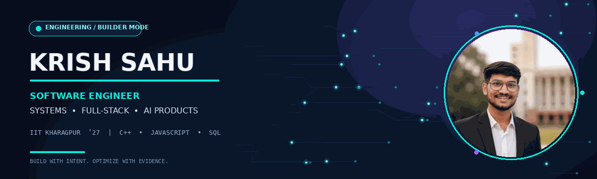
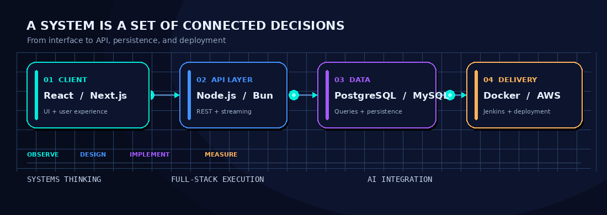

### I build software from the system call to the user interface.

*Final-year B.Tech. (Hons.) student at IIT Kharagpur · Chemical Engineering · Minor in Computer Science & Engineering*

---

## `whoami` — A little about me

- 🧩 **Systems:** I enjoy understanding what happens under the hood — processes, pipes, networking, concurrency, and file systems.
- ⚙️ **Full-stack:** I build end-to-end applications, from responsive interfaces to APIs, databases, and deployment.
- ✨ **AI products:** I like turning model capabilities into usable products with streaming UX, authentication, and real application workflows.
- 📈 **Performance mindset:** During my Software Development Internship at **Auditoria.AI**, I optimized queries over **21M+ rows**, reducing a dashboard lookup from roughly **5 minutes to ~15 seconds**.
- 🧠 **Currently learning:** Low-Level Design (LLD), High-Level Design (HLD), and better ways to design reliable systems.

> I like taking a complex problem apart, understanding the constraints, and building a solution that is useful, measurable, and maintainable.

## What I build

## Featured projects

<table>
  <tr>
    <td width="50%" valign="top">
      <h3>🧠 NovaMind AI</h3>
      <b>Full-stack AI SaaS · Built from scratch</b>  
      A multi-tool AI platform built from scratch with React, Express, PostgreSQL, real-time Server-Sent Events (SSE), authentication, usage tracking, a community gallery, and multi-format export. It has supported **250+ article and image generations**.  
      My proudest build: designing and building the product end to end.
    </td>
    <td width="50%" valign="top">
      <h3>🖥️ Custom Shell</h3>
      <b>C++ · Linux · Systems Programming</b>  
      A Unix-like shell focused on process execution, I/O redirection, background jobs, pipes, wildcard expansion, history, and signal handling.  
      <a href="https://github.com/krish-23CH10035/Custom-Shell">Explore repository →</a>
    </td>
  </tr>
  <tr>
    <td width="50%" valign="top">
      <h3>🌐 BitTorrent Client</h3>
      <b>C++20 · Networking · Concurrency</b>  
      A from-scratch client implementing Bencode parsing, SHA-1 piece verification, rarest-first piece selection, request pipelining, and tracker communication over HTTP/UDP (BEP 15).  
      <a href="https://github.com/krish-23CH10035/Bittorrent-Client-">Explore repository →</a>
    </td>
    <td width="50%" valign="top">
      <h3>🤖 QuickAI</h3>
      <b>AI product · Full-stack development</b>  
      An additional AI-focused project in my portfolio. Open the repository for implementation details and setup instructions.  
      <a href="https://github.com/krish-23CH10035/QuickAI">Explore repository →</a>
    </td>
  </tr>
</table>

### Other engineering work

- **AI Interviewer Platform:** Bun.js + PostgreSQL backend, automated candidate pipeline, Llama 3-based question generation, WebRTC audio streaming, and client-side MediaPipe processing.
- **ERP Sync Dashboard — Auditoria.AI internship:** React, Node.js and SQL; monitoring sync health across **750+ tenants**, reconciliation metrics, and staged Docker/Jenkins deployments. Internal company code and data are not published here.

## Tech stack

**Languages & core**  

**Application development**  

**Data, systems & delivery**  

**Core CS:** Data Structures & Algorithms · OOP · DBMS · Operating Systems · Computer Networks  
**Tools:** Postman · Swagger · Jupyter · MATLAB · Arduino IDE · n8n  
**Certified:** Oracle Cloud Infrastructure 2025 Certified AI & Generative AI Professional

## GitHub dashboard

  
  
   
  

## Contribution activity

  

## Engineering highlights

- 🧠 **750+ DSA problems** solved across LeetCode, GeeksforGeeks, Codeforces, AlgoZenith, and Coding Ninjas.
- 🏅 **3rd place** in an autonomous robotics maze-solving competition among 40+ teams.
- ☁️ **Oracle Cloud Infrastructure 2025 Certified AI & Generative AI Professional.**

## A few things I value

`Curiosity` · `Clear reasoning` · `Performance` · `Ownership` · `Continuous learning`

**Have an interesting engineering problem? Let's connect.**

[LinkedIn](https://www.linkedin.com/in/krish-sahu-iitkgp) · [Portfolio](https://krish-portfolio-page.netlify.app/) · [GitHub](https://github.com/krish-23CH10035)

Designed with code, curiosity, and a little motion.

